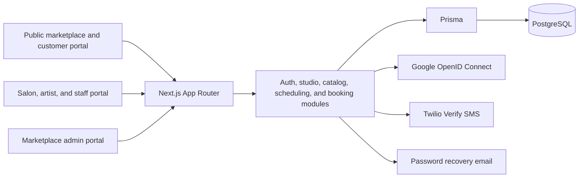
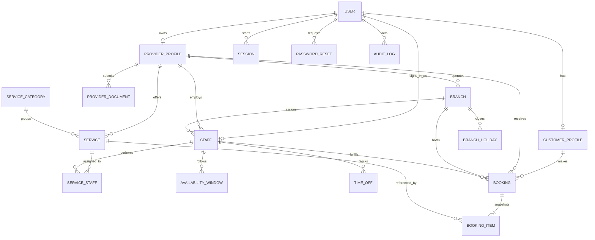

# Phase 1 architecture

Public search and profile reads are server-rendered. Browser forms use JSON route handlers. Roles and ownership are checked on the server. Access JWTs identify a revocable session record. Refresh tokens rotate on use and are stored as hashes. Authentication rate limits are written atomically to PostgreSQL. Admin decisions, document access, and booking changes create audit entries. Provider documents and payout identifiers use authenticated encryption in the database.

## Entity relationships

`Role`, provider type, approval state, and booking status are database enums. `OtpChallenge` records pending phone verification attempts, and `RateLimit` records bounded request counters. `Service.kind` supports regular services, packages sold as a single appointment, and add-ons. Bookings retain line names, durations, buffers, prices, and the provider’s cancellation deadline at the time of reservation.

## Availability and concurrency

1. Verify the provider is approved, the branch is active, and the selected staff can perform every service. The “any available” choice considers all eligible professionals at the branch.
2. Check the branch's holidays, then resolve working hours and breaks in its IANA time zone. Convert to UTC before checking staff blocks and bookings. Enumerate online starts every 15 minutes for up to 60 calendar days.
3. Sum service durations and buffers. For home visits, use straight-line distance to the submitted coordinates for the service-area radius, fee, and estimated two-way travel block.
4. On booking writes, take a PostgreSQL provider row lock and recompute the schedule inside the same transaction. Schedule and catalog edits also take this lock. A GiST exclusion constraint over each staff member’s occupied half-open UTC range prevents overlaps at the database layer. An idempotency key scoped to a customer makes booking submission retries safe.
5. Cancellation releases the time. Staff and providers can confirm, start, complete, decline, or mark a no-show when the current state allows. Customers can cancel or reschedule before the recorded deadline.

Rescheduling keeps the original booking items and price. An eligible incumbent can keep the appointment when a service has been edited or archived. Walk-ins reserve the actual start instant, share the provider lock and database exclusion constraint, and use a provider-scoped idempotency key.

Native PostgreSQL is the deployment database and enforces overlaps even for writes that bypass the application. A Redis cache or lock can be added in a later phase without changing the database correctness rule. [PostgreSQL range and exclusion constraints](https://www.postgresql.org/docs/current/rangetypes.html#RANGETYPES-CONSTRAINT)

## Generated assets

The built-in image generator produced the demo photography. The images were encoded as WebP for the app.

| File                          | Prompt brief                                                                                                                                                                                                                   |
| ----------------------------- | ------------------------------------------------------------------------------------------------------------------------------------------------------------------------------------------------------------------------------ |
| `public/images/hero.webp`     | Photorealistic South Indian beauty campaign portrait. Warm brown skin, soft rose makeup, loosely gathered dark hair and pink camisole, framed on the right beside a pale textured pink curtain. Soft window light and no text. |
| `public/images/rosewood.webp` | A sunlit Kochi hair salon with arched mirrors, blush-beige styling chairs, brass fixtures, taupe counters, and greenery. Editorial interiors photograph, no people or text.                                                    |
| `public/images/ananya.webp`   | Editorial portrait of a South Indian makeup artist in a cream linen blouse holding a makeup brush in a softly lit, neutral studio. No branding or text.                                                                        |
| `public/images/petal.webp`    | A close-up of petal-pink manicured hands on dusty lilac silk with thin gold rings. Soft light and sharp nail detail. No branding or text.                                                                                      |
